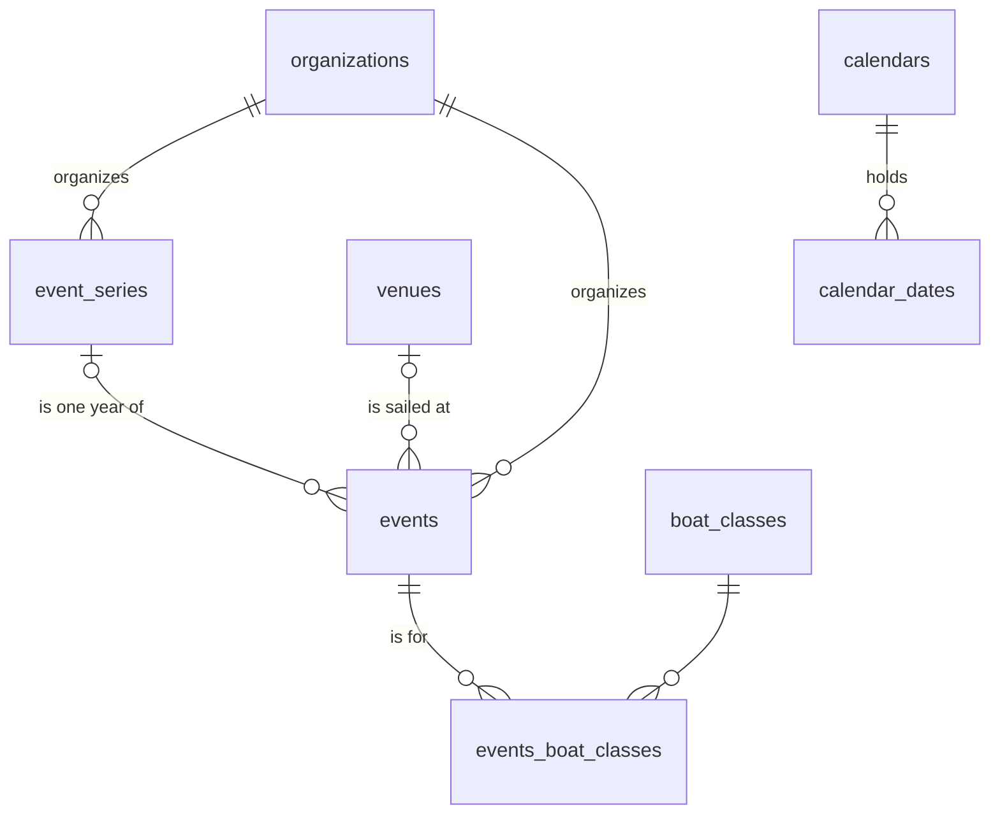

# The calendar

Race and program staff keep one calendar of the regattas and clinics other organizations run, and
of the holidays and school days off around them (cyc-seattle/platform#124). `schemas/calendar.yaml`
holds it, in the Data Studio's Calendar folder. A Calendar Writer changes it, and a Calendar Reader
sees it (`docs/access.md`).

## Events

- An event is one regatta or clinic on its dates, with one row even when several sites publish it.
  A blank `ends_on` is a one-day event.
- An event that comes back each year belongs to a series. The series names it and its organizer,
  and holds the page where its notice of race goes up each year. Each event keeps its own details,
  so correcting one year changes no other.
- `status` is Confirmed or Cancelled. A cancelled event stays, marked as cancelled. Projected and
  last year's events aren't stored: they're worked out on read from a series' events, so none goes
  stale when the real one is posted.
- `adopted` marks an event CSC supports.
- `source_url` is where staff found it, so a later watcher of organizers' pages can propose changes
  to the event it came from.
- Every link into the directory, the boat classes, a series or a calendar restricts delete, so an
  organization, venue, boat class, series or calendar still in use can't be deleted. Deleting an
  event drops its boat classes with it.

## Calendars

A calendar is a named list of dates, in its own colour, with no status:

- Holidays: public holidays, such as federal ones.
- School: one school district's days off, starting with Seattle Public Schools.
- Staff: staff's own dates, such as closures or training days.

Plans keep their own closed dates (`plan_closed_dates`), and planning never writes here.
