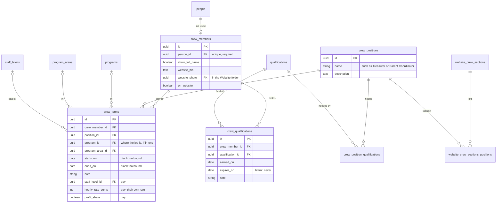

# Crew: schema

`schemas/crew.yaml` holds Crew: everyone who works for CSC, volunteers and staff, with their
positions, terms, qualifications, and what the public website shows of them
([cyc-seattle/platform#263](https://github.com/cyc-seattle/platform/issues/263)). It's in the Data
Studio's Crew folder. `features/crew.feature` gives the rules.

- **A crew member** is one person, once. Deleting a person on Crew is refused, as is deleting a crew
  member with terms or qualifications.
- **A position** is a job, such as Treasurer, Head Coach, or Parent Coordinator. It's general: a
  Parent Coordinator in each of three programs is one position and three terms. Directus calls a
  sign-in's access a role, so a job is never called one. A committee is a group, whose members an
  admin adds by hand, and a position doesn't name one. Giving access from positions is
  [cyc-seattle/platform#334](https://github.com/cyc-seattle/platform/issues/334).
- **A term** is one crew member in one position. It's current on a day when `starts_on` is blank or
  on or before it, and `ends_on` is blank or on or after it, by the calendar in Seattle:
  `isCurrentTerm` in `src/model/crew/` says so for the syncs. Ended terms stay. A term can name the
  program or program area its job is in, and gsuite-sync puts a term's holder in its program's Google
  Group. Deleting a program, program area, position, or staff level a term names is refused.
- **A term's pay** is its staff level, the person's own hourly rate if not the level's, and whether
  they get a share of the profit ([cyc-seattle/platform#125](https://github.com/cyc-seattle/platform/issues/125)).
  A coach is active while their term is current. An archived staff level (`staff_levels.archived_at`
  set) stays on the terms that have it, and the picker offers only the rest.
- **A qualification held** is one of the catalog's `qualifications`, earned on a date, and usually
  expiring on one. A renewal is a new row. Someone has a qualification while they hold one in date,
  or one that covers it (`qualification_covers`). Each position lists the qualifications it needs,
  so sail-team shows who is missing one, or holds one that expires in the next 90 days.
- **The public profile** is the crew member's name in the CRM, `website_bio`, `website_photo`, and
  `on_website`. The website build reads those, `show_full_name`, and the current terms of crew
  members on the website, and each position's name: never pay or qualifications
  ([website.md](website.md)).
- **The name on the website** is the person's first name, or first and last name when
  `show_full_name` is set. It's off by default. Nothing copies the name: the build reads the
  person's `first_name` and `last_name` itself, through a rule that shows only those two fields, and
  only of a person whose crew member is on the website (`people.crew_members`, a hidden list).
  A name changed in the CRM shows on the next publish, which runs nightly.

Directus can't compare one row with another, so nothing stops overlapping terms for one person in
one position. Sail-team shows both.

## Who can do what

| Policy                               | Reads                                                                                                               | Changes                                                 |
| ------------------------------------ | ------------------------------------------------------------------------------------------------------------------- | ------------------------------------------------------- |
| Crew Writer                          | Every Crew collection; people's names and emails; programs, program areas, qualifications, and staff levels by name | Every Crew collection, and photos in the Website folder |
| Crew Reader                          | The same, but a term's pay                                                                                          | Nothing                                                 |
| CRM Reader, CRM Writer               | Crew members' people, positions, and terms, but pay                                                                 | Nothing in Crew                                         |
| Plan Reader, Plan Writer, Plan Admin | Terms with their pay, crew members' people, positions' names, and people's names                                    | Nothing in Crew                                         |
| Website Build                        | Public profiles on the website, their current terms, and positions' names                                           | Nothing                                                 |

Groups give each of them, and an admin fills each group by hand. No role gets a Crew policy, and
the Crew role reads nothing in Crew. [access.md](access.md) has the rest.

A person merge moves a duplicate's crew member to the person kept, when it's the only one in the
group. When two of them are on Crew, nothing moves, and the merge stops on the final delete until an
admin settles it.
