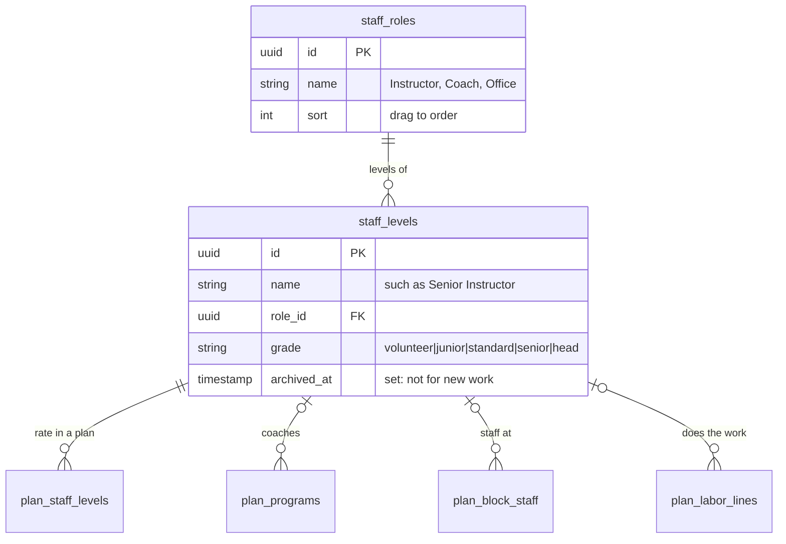

## HR: schema

`schemas/hr.yaml` declares the staff levels hourly staff are paid at, in the Data Studio's HR folder. They're part of the catalog: Catalog Writers change them, and Catalog Readers and every Plan policy see them. Each Financial Plan sets what each level is paid an hour, in its Operations Plan's `plan_staff_levels` ([Planning: schema](planning-schema.md#operations-plan)).

A level is a role at a grade, such as Senior Instructor. The grades, in order, are Volunteer, Junior, Standard, Senior and Head. A standard grade adds no word to a level's name, so it's just "Instructor". A level has a row only where a role takes that grade: Volunteer Coach is an adult who volunteers as a coach, and Junior Instructor a youth who volunteers. Each level's `name` is typed by a Catalog Writer, since Directus can't build it from the role and grade. A level is unpaid when a plan's rate for it is $0, so being a volunteer is the plan's to say, not the level's.

Planning lists levels by their role's `sort`, then by grade: `sortStaffLevels()` and `STAFF_GRADES` in `@cyc-seattle/platform/planning` give that order. The Data Studio lists them by role, then by name.

A role with levels, or a level a plan or a Crew term uses, can't be deleted. A level no longer used for
new work is archived instead, by setting `archived_at`: it stays with the plans and terms that have
it, and the Data Studio's default view and a term's picker leave it out. Directus's own archive takes
a fixed value, not a time, so the collection's archive setting stays off and the view filters instead. A frozen Financial Plan doesn't copy the catalog, so renaming a level renames it in every plan, frozen ones included. Its rates, and its results, stay as they were.

Directus can't make a pair of columns unique, so nothing stops two levels with the same role and grade, or two of a plan's rates for one level. The engine then uses whichever rate it reads last.

Qualifications aren't linked to levels yet. Nothing would read the link.

### Where the levels came from

Before cyc-seattle/platform#295, each plan named its own levels. The migration (`cyc0018`) mapped each plan's levels by name onto these, kept each plan's rate, and made a volunteer's rate $0:

| Old name                               | Level             |
| -------------------------------------- | ----------------- |
| Volunteer                              | Volunteer Coach   |
| 1 - min wage                           | Instructor        |
| 2 - experienced                        | Senior Instructor |
| 3 - coach                              | Coach             |
| 4 - head instructor                    | Head Instructor   |
| Summer head instructor (level 4 + 10%) | Head Instructor   |
| 5 - senior staff                       | Head Coach        |
| G&A hourly labor (level 3 rate)        | Office Staff      |

A plan with both head instructor levels kept one rate, the head instructor's, so its summer head instructor's hours cost that rate. A name not in the list became a level of its own, an Instructor at the standard grade. Junior Instructor was added with no plan using it yet.
