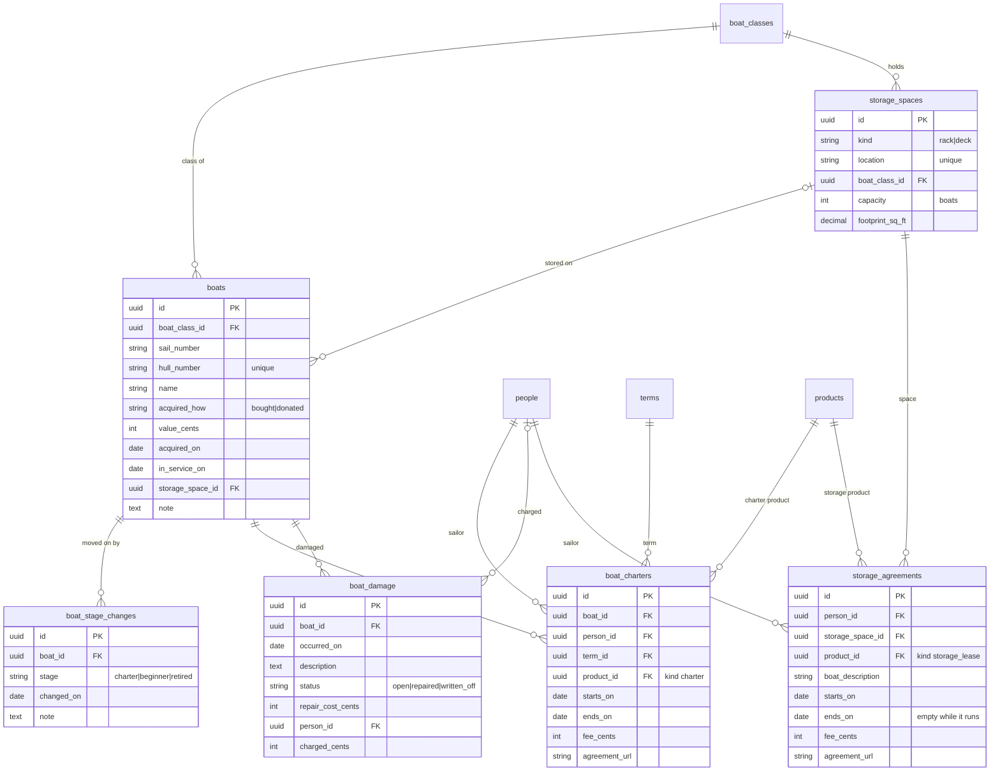

## Inventory: schema

`schemas/inventory.yaml` declares the register of the club's own boats, who charters them, damage to
them, and the racks and deck space boats are stored on (cyc-seattle/platform#126). Sailors' own
boats aren't in the register: a storage agreement describes one in words. Program directors keep it
up to date, with the Inventory Writer policy ([access.md](access.md)).

The planning engine doesn't read it yet. Costing a boat's wear and storage to the programs that use
it comes later, as a boat replacement reserve line below operating net, for information. Capital
stays out of operating costs (cyc-seattle/workplace#6 decision 23).

A boat's stage is its latest `boat_stage_changes` row: its charter life, its beginner life, or
retired. A boat moves on by a new row, never by an edit, so the Inventory Writer policy can add a
row but not change or delete one. An admin fixes a mistake. Nothing stores the stage on the boat,
so a page works it out from the rows.

`terms` lives in the catalog (`schemas/core.yaml`), for other domains to use too. A program director
closes a term by setting its `closed_on`, so its boat costs stop changing, and clears it to reopen
the term. That's the only catalog field the Inventory Writer policy changes.

A charter and a storage agreement name a product, of kind Charter or Storage lease, not a catalog
offering, since a catalog offering is always a program's. Agreements are links to the signed copy,
not uploaded files.

Every link to `people` restricts delete, and the Clubspot sync's person merge moves a duplicate's
charters, damage and storage agreements onto the person it keeps. Deleting a boat, a term or a
storage space that something still names fails. Deleting a storage space with boats on it leaves
those boats with no space.
