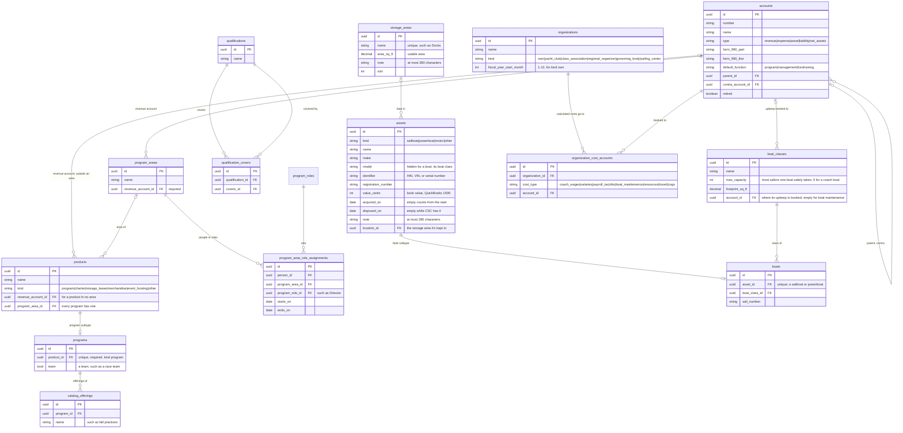
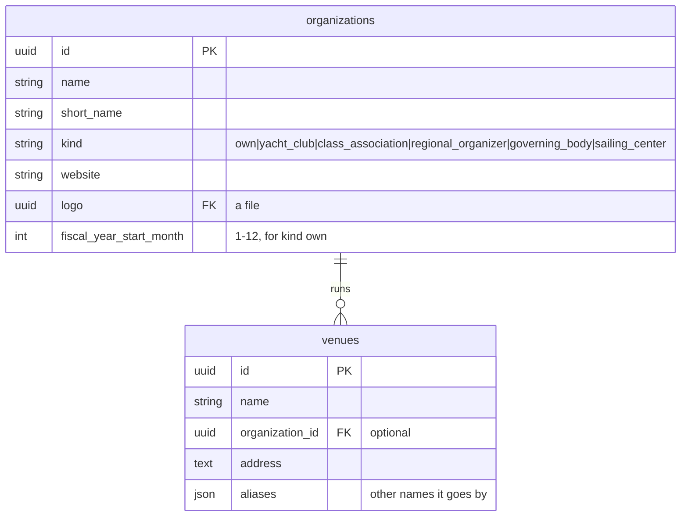
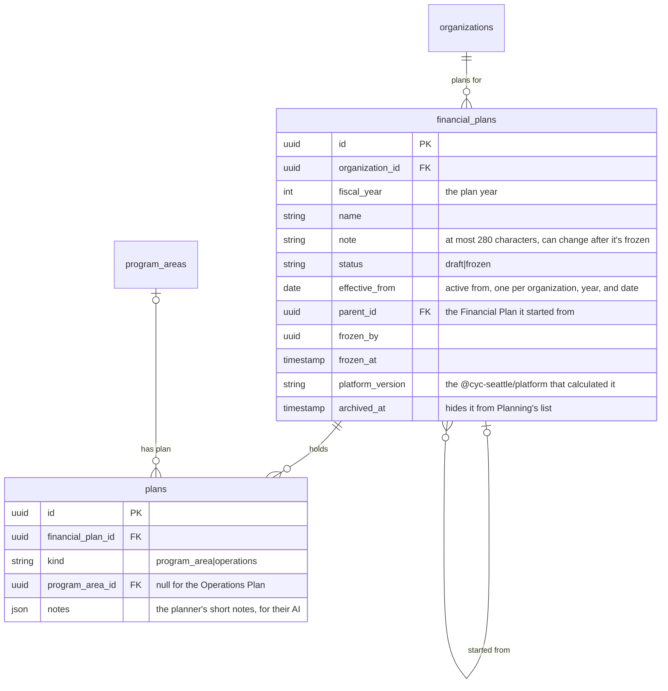
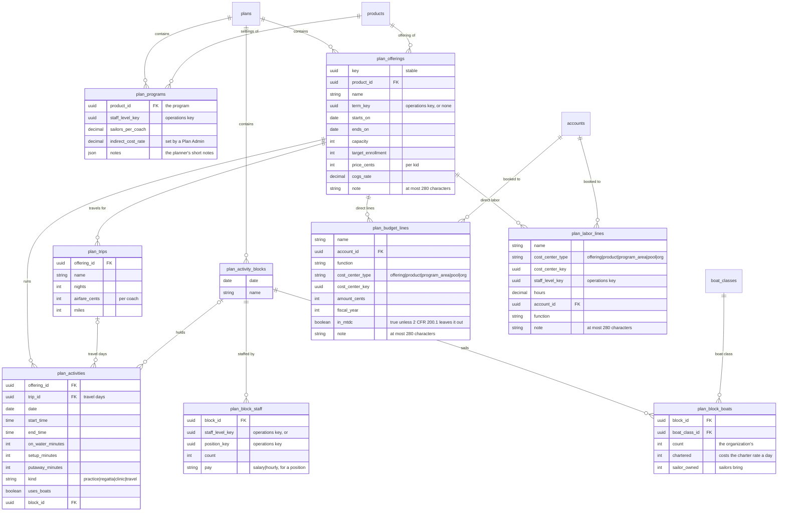
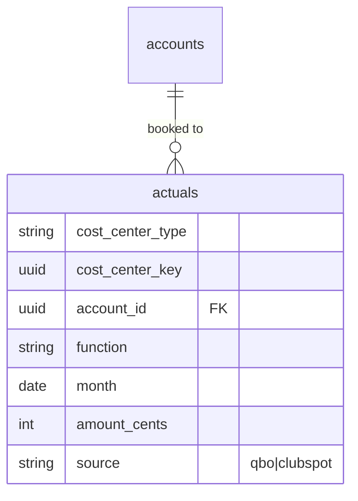

## Planning: schema

Entity-relationship diagrams for the program planning and financial model app. `schemas/core.yaml` declares the `core` catalog, and `schemas/directory.yaml` the organizations it belongs to. `schemas/planning.yaml` declares Financial Plans, the plans they hold, every row a plan holds, and the date each Financial Plan is active from. Baselines and actuals are designed here, but not built yet.

A Financial Plan holds what planners enter, and the results the [planning engine](planning-engine.md) calculates from it ([A Financial Plan's results](#a-financial-plans-results)). A draft's are worked out again a moment after each change to it. A frozen one's are worked out when it's frozen, and never change.

### Terms

- **Product:** a lasting thing CYC sells, such as J-Pod, boat charters or storage leasing. Products live in the new `core` domain.
- **Program:** a product of kind `program`, such as J-Pod. A program with `team` set is a team, such as a race team. Each application groups programs its own way: the website by category, Google Workspace by Group. A program's `color` is its color on calendars and charts in every app: `programColor()` in `@cyc-seattle/platform/planning` gives the one a Catalog Writer set, or else one of `PROGRAM_PALETTE`'s twelve, picked by its id, so it stays the same everywhere.
- **Program area:** one part of the organization's programs, such as Summer or Singlehanded, with one revenue account. People hold roles in it, such as Director, the way they hold program roles, and its directors plan it. Every program belongs to one. Areas are the program services the organization reports in Part III of Form 990. Merchandise, storage and charters belong to none.
- **Offering:** a product sold for a period, such as J-Pod Fall 2027 or Guppies summer week 3. A program offering is one Clubspot session × class, the unit Clubspot caps enrollment on.
- **Activity:** one dated, timed event that uses coaches, boats or other resources, such as a practice, a regatta day or a travel day. The planner, or a scheduling tool, enters each one.
- **Activity block:** offerings whose activities share coaches and boats on certain days, set up by the planner. For example, J-Pod and K-Pod on Wednesdays.
- **Cost center:** what a money line belongs to. That is an offering, a product or a program area (each divided among its offerings), a pool (G&A, program admin), or the org. Strictly speaking, an offering that earns revenue is a profit center, but we call all of these cost centers.
- **Bonus owner:** a role, such as a program area's director. It owns a set of products and earns a bonus on their net. Every bonus is in the Operations Plan.
- **Catalog offering:** a named offering of a program, such as "J-Pod · fall practices" or "Summer camp · week 3", kept in the catalog. Every Financial Plan's offerings point at one, and so do Clubspot's offerings, so a Clubspot offering finds its plan in whichever Financial Plan is in force.
- **Plan** (`plans`): one part of a Financial Plan, with every row it holds. A **Program Plan** holds one program area's offerings for the year. The **Operations Plan** holds what the areas share, the charges set as a share of revenue, and the products in no area: merchandise, storage and charters.
- **Financial Plan** (`financial_plans`): the organization's plan for a year: one Operations Plan and a Program Plan for any of the program areas, with the P&L they make together. Planners change its plans while it's a draft. Freezing it keeps it, and its plans, from changing, apart from its name, its note, its date and whether it's archived. A new one starts as a copy of its parent, so two started from the same parent are options to compare, like branches in git.
  - The Financial Plan **in force** on a day is the one for its organization and year with the latest `effective_from` on or before that day: the plan being run, which tracking compares with what happened.

### Diagram conventions

Every row of a plan also has an `id`, a `plan_id` and a `key`. A new row gets a random `key` unless it's given one, and a copy into a new draft keeps it. A `key` should be unique within its plan, but Directus can't make a pair of columns unique, so nothing checks it. The diagrams below leave these out except where they matter.

Arrays are shown as `json`.

Dashed lines are references by stable `key` across plans. The engine looks them up within a Financial Plan; they are not database foreign keys.

### `core` catalog

`programs` is the subtype of a product of kind `program`, per `AGENTS.md`'s subtype pattern. A product with a program can't be deleted.

A program area has one revenue account, and a product in an area books its sales there. A product's own `revenue_account_id` is for products in no area, and the Data Studio hides it once an area is set. The Data Studio asks for an area on a program and hides it on other kinds, but the database doesn't require one, since prod's programs had none when areas arrived. The engine warns about a program with no area, and the Google sync's audit about a product whose own account differs from its area's. A program area with products can't be deleted. Who holds a role in an area, such as Director, is in `program_area_role_assignments`, in the CRM schema beside `program_role_assignments`, with the same access: the CRM policies. Anyone who signs in can see each area's name. `organizations` is in the [directory](#directory); our own, of kind `own`, hold their fiscal year, and only they can have a plan or a Financial Plan. `organization_cost_accounts` lists which account each calculated cost (coach wages, payroll tax, and so on) is recorded in, one row per cost type. Directus can't make a pair of columns unique, so nothing stops a second row for a cost type, and the engine then uses whichever it reads last. Staff levels and boat rates name no account; a boat class can name the account its upkeep goes to. QuickBooks Classes split those accounts by program, which the engine's per-product P&L shows. `assets` is the asset list: each boat and piece of equipment CSC owns, by `kind`: a sailboat, a powerboat such as a coach boat, a motor, or other, such as a trailer or the van. `value_cents` is its book value, as in QuickBooks account 1500. A sailboat or powerboat also has a `boats` row, with its class, such as Opti or RIB, per `AGENTS.md`'s subtype pattern; its class is its model, so the Data Studio hides `model` for one. The engine counts the boats of each class that CSC has on each day: from `acquired_on`, or from the start when it's empty, until `disposed_on`. A boat CSC plans to buy is a row with the date it's expected. Motors and other assets are listed, not counted. A boat class with boats can't be deleted. Each asset's `location_id` names the storage area it's kept in, such as Docks, Dry Storage or Yard Arm, which has its usable `area_sq_ft`; Sail Team's Inventory compares what each area holds with it. A storage area with assets can't be deleted. The powerboat classes, RIB and Support, take 0 sailors, and their `account_id` books their upkeep to Coach boats; a class with none books it to boat maintenance. Catalog Writers change the list, and Catalog Readers and planners see it.

### Directory

The directory is who runs an event and where: the clubs and organizers we sail with, our own organizations among them, and their venues. Only an admin changes it; the catalog and plan policies read it. A venue's organization is optional, since we don't track who runs a public marina. Every foreign key to it restricts delete, so an organization or venue still in use can't be deleted. A venue's location and time zone come with the dusk rule.

### Financial Plans

A Financial Plan is for one organization and one plan year (`fiscal_year`), and holds one Operations Plan and at most one Program Plan for each program area. A Program Plan names its program area, and an Operations Plan names none. A plan is in one Financial Plan, and never moves to another. A year can have several drafts at once, to weigh options.

A plan's `notes` hold what the planner wants that the plan's numbers don't capture, in their own words, such as "every Monday, Wednesday and Friday, except on school holidays, from 4pm until dusk". It's a list of short notes, each one line of at most 280 characters, with inline markdown. Their AI reads them when it fills in the plan. The engine never does. Like every input, they're frozen with the Financial Plan.

Every `note` a person writes, on a Financial Plan, an offering, a line, a charge, a capital item or an asset, holds at most 280 characters, with inline markdown only: bold, italic, code and links.

A planner starts a Financial Plan by adding a `financial_plans` row. Given a `parent_id`, a Financial Plan for the same organization and year, the `frozen-plans` hook copies the parent's plans into it a moment after: a draft copy of each, with every row, each keeping its `key`, and each link pointing at the copy of the row it linked to. A Plan Admin can also add a plan to a draft, or delete one with its rows. Its organization, year, and parent never change. Deleting a draft Financial Plan deletes its plans, their rows and its results.

A Plan Admin freezes a Financial Plan by setting its `status` to `frozen`, and the database refuses it without an Operations Plan. Freezing is one way. The hook records the `platform_version` of the engine (`@cyc-seattle/platform`) that calculates the results, whatever the request sends: the package's version and a hash of the engine's code. Then it works out the results again ([A Financial Plan's results](#a-financial-plans-results)). A frozen Financial Plan never changes, apart from its `name`, its `note`, such as "Reviewed with the board", the date it's active from, and whether it's archived. A Program Plan's row that names an Operations Plan row by key, such as `coach_level_key`, means the row with that key in the Operations Plan of the same Financial Plan.

A frozen Financial Plan doesn't copy the catalog. Recalculating an old one uses the catalog as it is today: today's products, accounts, boat classes, and the organization's fiscal year.

A Plan Admin makes a Financial Plan active by giving it an `effective_from` date (cyc-seattle/platform#251). The plan in force on a day is the one for its organization and year with the latest date on or before it, until the next one's date, and `planInForce` in `@cyc-seattle/platform/planning` finds it. A draft can be active: directors keep changing it while it's in force, and its results keep up. Freezing it stops it changing, and it stays in force. A Plan Admin can change or clear any Financial Plan's date, a frozen one's included. No two for an organization's year share a date, which the trigger checks and a partial unique index on `financial_plans` backs. An active Financial Plan can't be deleted until its date is cleared. Directus's revisions record who changed a date, and when. Today is the database's date, in UTC.

A Plan Admin archives a Financial Plan, a draft or a frozen one, by setting `archived_at`, which hides it from Planning's list, and clears it to bring the plan back. Archiving changes nothing else, so a frozen one can be archived too. The plan in force can't be archived, nor can one active from a later date, and an archived one can't be given a date (cyc-seattle/sail-team#82).

#### A frozen Financial Plan never changes

A frozen Financial Plan, every plan in it, and every row in those, never change, even for an admin. Directus skips permissions for an admin, so two things enforce it:

- The `frozen-plans` hook (`stacks/backend/frozen-plans.cjs`) refuses such a request with a 403 and a clear reason. Directus runs its filters for every user. The hook also stamps who froze a Financial Plan. A write that skips the hook, such as a flow's data step, leaves `frozen_by` empty.
- Database triggers refuse the same writes on every path, including the ones that skip Directus's filters, such as a flow's data steps. The hook installs them when Directus starts, and again after each schema change if they've changed or a table lost its trigger. An install gives up after 5 seconds waiting for a lock, and logs the failure. The `frozen-plans-check` step of the `backend` deploy, which runs whenever the schema or the triggers change, fails the deploy if a planning table lacks its trigger. Each one locks the Financial Plan it checks until the write commits, so a Financial Plan can't be frozen while a write to one of its rows is still open. Directus shows a trigger's refusal with its reason when it creates or updates a row. When it deletes one, it answers with a 500, which shows the reason only to an admin.

Together they refuse:

- changing a frozen Financial Plan, apart from its name, its note, its date, and whether it's archived, turning it back into a draft, or deleting it
- freezing a Financial Plan without an Operations Plan, or without a `platform_version`
- a new Financial Plan that isn't a draft, or one that starts from another organization's or year's
- changing a Financial Plan's organization, year, or parent
- adding, changing, or deleting a frozen Financial Plan's plans, or a row in one of them
- a second Operations Plan, or a second Program Plan for an area, in one Financial Plan
- moving a plan to another Financial Plan, or a row to another plan
- a row that links to a row in another plan, such as an activity whose `offering_id` is another plan's offering
- a Program Plan without its program area, or an Operations Plan with one
- a note in a plan's or a program's `notes` that isn't one line of at most 280 characters
- writing a Financial Plan's results, except by the hook, a whole set at a time into one with none, or changing or deleting a frozen one's
- two Financial Plans for an organization's year active from the same date, deleting an active one, archiving the plan in force or one active from a later date, or giving an archived one a date
- a bonus, or a bonus's product, in a Program Plan

A row's link to a catalog row restricts delete, so deleting a catalog row a plan uses fails instead of reaching into a frozen plan. A row's link to its plan, and a plan's to its Financial Plan, cascade, so deleting a draft takes everything in it. Links between rows of one plan, such as an activity's block, are checked at the end of the statement, so a cascade can delete both.

An admin can still get past this in two ways, as a last resort: by changing a planning collection's fields or relations in the Data Studio, which changes the table itself, or by running SQL as the database's owner, which can turn the triggers off. In dev, `backend:frozenPlansDeletable` lets the integration tests delete a frozen Financial Plan, with its plans, their rows, and its results, so they can clean up. Through the API, only the first admin account can. The triggers can't tell which Directus user is writing, so in dev's database they allow those deletes on every path. The prod stack refuses that flag.

### Program Plan

All of an offering's revenue and costs go in its plan's year, and its dates may run past either end of that year, as a winter program's do ([cyc-seattle/platform#252](https://github.com/cyc-seattle/platform/issues/252)). Its enrollment is a whole number of kids, and its revenue is `price_cents` × enrollment.

An offering can be in one of its Financial Plan's terms, by `term_key`, or in none, such as Adult Learn to Sail (cyc-seattle/platform#251).

An offering can be in one of its Financial Plan's terms, by `term_key`, or in none, such as Adult Learn to Sail (cyc-seattle/platform#251).

Each activity is a dated row. The planner enters them, or a tool such as a scheduler or an agent writes them; nothing creates them automatically. A travel day is an activity of kind `travel`, linked to its trip.

Each program has one `plan_programs` row in its area's Program Plan: the staff level that coaches it, how many sailors one coach at that level can take, its indirect cost rate, and its `notes`. The indirect cost rate is the share of the program's MTDC it pays toward the shared costs, fixed for the year ([docs/planning-engine.md](planning-engine.md#indirect-costs)). A director's bonus counts it, so only a Plan Admin sets it. Like a plan's own `notes`, a program's are the planner's short notes for their AI, and the engine never reads them ([cyc-seattle/platform#149](https://github.com/cyc-seattle/platform/issues/149)). Being in a plan, they're copied with it, so two drafts can try different settings. Directus can't make a pair of columns unique, so nothing stops a second row for a program, and the engine then uses whichever it reads last.

A block, in `plan_activity_blocks`, is one or more activities on one date that share their staff and boats, such as Guppies and Minnows on the morning of July 13. Each activity is in at most one block, through `block_id`. A block's rows say what it's given: `plan_block_staff`, a number at a staff level or one salaried position, paid out of the salary or by the hour; and `plan_block_boats`, its boats of a class, sailboats or powerboats such as coach boats: the organization's own, the ones it charters, and the ones sailors bring. The planner, or their AI, writes them. Nothing derives them, and nothing records which rule made them. Every foreign key restricts delete, so a block's rows, and its activities' `block_id`, go before the block does.

A program area's plan holds only offerings of that area's programs, and the engine warns about any other.

A budget line counts in its `fiscal_year`. Capital belongs in the Operations Plan's ranked `plan_capital_items`. A budget line on an asset account is capital too, and is the organization's: fundraising pays for it, so it never reaches an area or an offering, and the engine moves it to the organization with a warning. A cost on a product or a program area is divided among its offerings by MTDC (modified total direct costs: an offering's own costs, less a few kinds a federal grant rule leaves out). Clearing `in_mtdc` leaves a cost out of MTDC, as [2 CFR 200.1](https://www.ecfr.gov/current/title-2/section-200.1) does for equipment, rent, participant support and the rest.

`plan_labor_lines` hold labor not tied to an activity, such as head-instructor weeks, training and boat-maintenance labor, priced at a staff level.

### Operations Plan

```mermaid
erDiagram
    plans ||--o| plan_rates : contains
    plans ||--o{ plan_staff_levels : contains
    plans ||--o{ plan_salaried_positions : contains
    plans ||--o{ plan_pools : contains
    plans ||--o{ plan_bonus_owners : contains
    plans ||--o{ plan_closed_dates : contains
    plans ||--o{ plan_terms : contains
    plans ||--o{ plan_capital_items : contains
    accounts ||--o{ plan_capital_items : "booked to"
    boat_classes ||--o{ plan_boat_rates : "rate for"
    plan_salaried_positions ||--o{ plan_salaried_bookings : "management hours"
    products |o--o{ plan_salaried_bookings : "booked to"
    program_areas |o--o{ plan_salaried_bookings : "booked to"
    plans ||--o{ plan_revenue_charges : contains
    accounts ||--o{ plan_revenue_charges : "booked to"
    plan_salaried_positions }o--o| plan_pools : "rest of salary to"
    plan_bonus_owners ||--o{ plan_bonus_owner_products : owns
    products ||--o{ plan_bonus_owner_products : "owned by"

    plan_rates {
        decimal payroll_tax_rate "share of wages"
        int lodging_per_night_cents
        int mileage_rate_cents
    }
    plan_staff_levels {
        string name
        string pay_type "hourly|volunteer"
        int hourly_rate_cents
    }
    plan_salaried_positions {
        string name
        int annual_salary_cents
        int paid_hours_per_year
        decimal ga_share
        uuid remainder_pool_id FK
        int hourly_coaching_rate_cents "its own rate, when paid by the hour"
    }
    plan_salaried_bookings {
        uuid position_id FK
        uuid product_id FK "or the area"
        uuid program_area_id FK "or the product"
        decimal hours
    }
    plan_boat_rates {
        uuid boat_class_id FK
        int fuel_per_hour_cents "each hour one of its boats is on the water"
        int maintenance_per_boat_hour_cents "upkeep, each hour on the water"
        int charter_per_day_cents "each day one is chartered"
    }
    plan_pools {
        string name
    }
    plan_revenue_charges {
        string name
        decimal rate "share of each offering's revenue"
        json product_kinds
        uuid account_id FK "revenue adds revenue, expense a cost"
        boolean in_mtdc "true unless 2 CFR 200.1 leaves it out"
        string note "at most 280 characters"
    }
    plan_bonus_owners {
        string role_name
        decimal bonus_rate
        uuid account_id FK
        string basis "after_shared_costs|before_shared_costs"
        uuid position_key "operations key: the position it pays"
    }
    plan_closed_dates {
        date date
        string name
    }
    plan_terms {
        uuid key "stable"
        string name "such as Summer 2027"
        date starts_on
        date ends_on
    }
    plan_capital_items {
        string name
        int amount_cents
        uuid account_id FK "an asset account"
        int sort "rank: 1 is the most needed"
        string note "at most 280 characters"
        string link "a quote or listing"
    }
    plan_bonus_owner_products {
        uuid bonus_owner_id FK
        uuid product_id FK
    }
```

`plan_rates` holds the year's rates, in at most one row per version. Each staff level, salaried position and boat class also has one rate for the year, so each has a single row. A boat class's rates are its fuel and upkeep for each hour one of the organization's boats is on the water, and what one costs to charter for a day.

The plans don't say how many boats the organization has: the [asset list](#core-catalog) does, the same for every plan. The engine warns when the blocks give out more of the organization's boats of a class at once than it has that day; chartered boats don't count.

`plan_revenue_charges` lists the charges set as a share of revenue, such as scholarships, the program buffer, B&O tax, and card fees. Each applies to every offering of the product kinds it names, at its rate × the offering's revenue. A charge on a revenue account adds revenue, such as the card fees families pay; on an expense account, it adds a cost. Clearing `in_mtdc` leaves it out of MTDC, as for scholarships, which are participant support.

The Operations Plan also holds the offerings of products in no area: merchandise, storage and charters. It also holds each program area's storage rent, such as the dinghy float, as a line charged to the area and booked to the Storage account under 7350 Occupancy/Rent, which sail-team's Storage tab reads (cyc-seattle/platform#251).

A salaried booking names a product, or a program area whose offerings share it by MTDC.

A pool is a group of shared costs that no single offering owns, such as general and administrative (G&A) costs or program admin. It holds the lines put in it, and the part of a salaried person's pay that isn't charged to a program. The programs pay toward the pools at their indirect cost rates, and what the rates don't recover stays with the organization ([Indirect costs](planning-engine.md#indirect-costs)).

A bonus owner's bonus is `bonus_rate` × the net of its products for the year, after or before its indirect costs (`basis`), if that net is above zero. Every bonus is in the Operations Plan, which the database enforces. `position_key` names the salaried position the bonus pays, so the engine can add up that person's pay.

`plan_capital_items` is the ranked list of what the organization means to buy, such as a coach boat, with the most needed first. Planners drag the rows into order in the Data Studio. Each is capital on the organization, and the engine says how far down the list the year's money goes.

`plan_terms` lists the planning periods, such as Summer 2027, each with its first and last day. A Program Plan's offering names one by its key, `term_key`, or none. Terms are in the Operations Plan, so every Program Plan shares them. A term's dates don't limit its offerings' dates. A plan frozen before terms (cyc-seattle/platform#251) has none.

`plan_closed_dates` lists the days the organization is closed, such as Labor Day. Agents read them when they write activities, and the engine warns about an activity on one.

The Operations Plan also holds `plan_budget_lines` and `plan_labor_lines` for pool and org lines (insurance, the clubhouse fee, fundraising, equipment). They have the same shape as an area plan's lines.

### A Financial Plan's results

```mermaid
erDiagram
    financial_plans |o--o| plan_results : "organization's totals"
    financial_plans |o--o{ plan_result_lines : lines
    financial_plans |o--o{ plan_result_pnl : "P&L"
    financial_plans |o--o{ plan_result_positions : pay
    financial_plans |o--o{ plan_result_bonuses : "bonuses, by term"
    financial_plans |o--o{ plan_result_capital : "capital, ranked"
    financial_plans |o--o{ plan_result_warnings : warnings
    plans |o--o{ plan_result_lines : "charged in"
    plans |o--o{ plan_result_pnl : "charged in"
    plans |o--o{ plan_result_bonuses : "paid in"
    plans |o--o{ plan_result_warnings : about
    accounts ||--o{ plan_result_lines : "booked to"

    plan_results {
        uuid financial_plan_id FK "unique"
        timestamp calculated_at
        string platform_version "the engine that worked them out"
        int operating_revenue_cents
        int operating_expense_cents
        int operating_net_cents
        int fundraising_revenue_cents
        int fundraising_expense_cents
        int fundraising_net_cents
        int capital_cents
        int total_cents
    }
    plan_result_lines {
        uuid financial_plan_id FK
        uuid plan_id FK "the plan it's charged in"
        string cost_center_type
        uuid cost_center_key
        string cost_center_name
        uuid account_id FK
        string function
        int amount_cents
        text line "the engine's key"
        text line_name "such as G&A share: Payroll tax"
        text explanation
    }
    plan_result_pnl {
        uuid financial_plan_id FK
        uuid plan_id FK
        string level "offering|product|program_area|program_area_term"
        uuid subject_key
        string name
        int revenue_cents
        int expense_cents
        int net_cents
        int mtdc_cents
        int enrollment
        int days
        int sailor_days
        int allocation_holds
        int breakeven_enrollment
        uuid term_key "for program_area_term; null is no term"
        string term_name
        date term_starts_on
    }
    plan_result_bonuses {
        uuid financial_plan_id FK
        uuid plan_id FK "the plan that pays it"
        uuid bonus_owner_key
        string name "the role"
        uuid term_key "null is no term, on the year"
        string term_name
        date term_starts_on
        decimal bonus_rate
        int net_cents
        int bonus_cents
        uuid program_area_key "null when its products span areas"
    }
    plan_result_positions {
        uuid financial_plan_id FK
        uuid position_key
        string name
        int salary_cents
        decimal salaried_coaching_hours
        int salaried_coaching_cents
        decimal hourly_coaching_hours
        int hourly_coaching_cents
        decimal booking_hours
        int booking_cents
        int bonus_cents
        int total_pay_cents
        int payroll_tax_cents
        decimal double_booked_hours
        int double_booked_dates
    }
    plan_result_capital {
        uuid financial_plan_id FK
        int rank
        uuid item_key
        string name
        int amount_cents
        int running_cents "this and everything above it"
        boolean funded "the year's money covers it"
    }
    plan_result_warnings {
        uuid financial_plan_id FK
        uuid plan_id FK "the plan it's about"
        string code
        text message
        string subject_key
        date date "the date it's about"
        string category "allocation|data"
    }
```

The `frozen-plans` hook runs the engine on the plans a Financial Plan holds and writes its results. Since a Financial Plan holds every plan it counts, the organization's totals are right.

A draft's results are worked out again after each change to what they come from, wherever it was made: the app, the Data Studio, or MCP. That's one of its plans, a row in one, or the catalog and organization the engine reads, which changes every draft's. Directus runs the hook's actions after it commits a write. The hook waits until a draft's writes have stopped for a second, or 10 seconds after the first, so a burst of them, such as an agent's over MCP, costs one run. It runs one draft at a time, on Directus's main thread. It replaces the draft's results in one transaction, under the locks a freeze takes, so readers see the old results or the new, never a mix. If that fails, it clears them, so no stale numbers look current, and logs why. When Directus starts, it works out the results of every draft that has none. A write that skips Directus's actions, such as SQL, leaves a draft's results as they were until its next change; `calculated_at` says when they were worked out.

A new engine doesn't work out a draft's results again (cyc-seattle/platform#284). Each `plan_results` row records, in `platform_version`, the engine that worked it out, and `GET /frozen-plans/engine` answers any signed-in user with the engine Directus runs now. A draft whose results came from another engine, or from before results recorded one, shows that in Sail Team. Anyone who may edit the Financial Plan can have them worked out again with `POST /frozen-plans/drafts/<Financial Plan id>/results`, which answers once they're written. It refuses a frozen one.

Freezing a Financial Plan clears its draft results in the same statement, and the hook works them out again a moment after the freeze answers, with the engine whose version it records. Then they never change.

`plan_results` holds the organization's totals. Each line and P&L row names, in `plan_id`, the plan that holds what it's charged to: an offering goes with its own plan, and a product or program area with that area's Program Plan. Everything else, including pools and the organization, goes with the Operations Plan. So one Program Plan's P&L, with its wages, powerboats and indirect costs, is one filter. A warning names the plan it's about, if there is one, and the date. Its `category` is `allocation` when the blocks break a limit or run on a closed day, and `data` when a row is missing or wrong ([Warnings](planning-engine.md#warnings)). A program area's P&L by term goes with the area's Program Plan, and a bonus with the plan that pays it. Each P&L by term and each bonus keeps its term's name and first day, as they were when it was worked out. Positions are the whole calculation's. The hook writes `plan_results` last, so a Financial Plan that has it has all its results. If the engine fails, it stays frozen with no results, and the hook logs why. An admin can fill them in with `POST /frozen-plans/results/<Financial Plan id>`. If copying a parent fails, `POST /frozen-plans/copy/<Financial Plan id>` tries again, and does nothing for one that already has plans.

Only the hook writes results. Its filter refuses any write to them through the API, even an admin's, and the triggers refuse a result row unless the hook's transaction has set `cyc.writing_results`, and the Financial Plan has no results yet. They refuse to delete a draft's results without it too, apart from the delete of the draft, or of one of its plans, taking its results with it. No result row is ever changed, and a frozen one's are never deleted. Anyone with a Plan policy can see them, a draft's the same way as a frozen one's. A draft with no `plan_results` row is still being worked out, or the engine failed on it.

Each result line's `line_name` says in plain words what it is, such as "Coach wages" or "G&A share: Payroll tax". `line` is the engine's key for it.

### Actuals

Actuals are what QuickBooks and Clubspot recorded. To compare them with a plan, add up a plan year's actuals and compare them with the engine's lines for the same cost centers and accounts.
