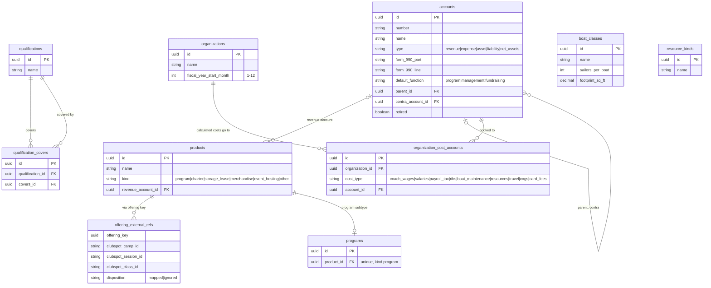
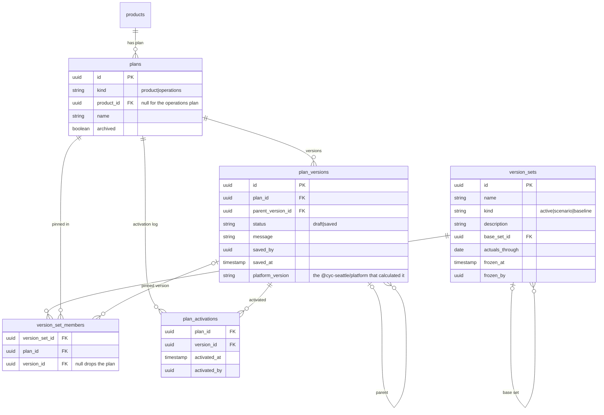
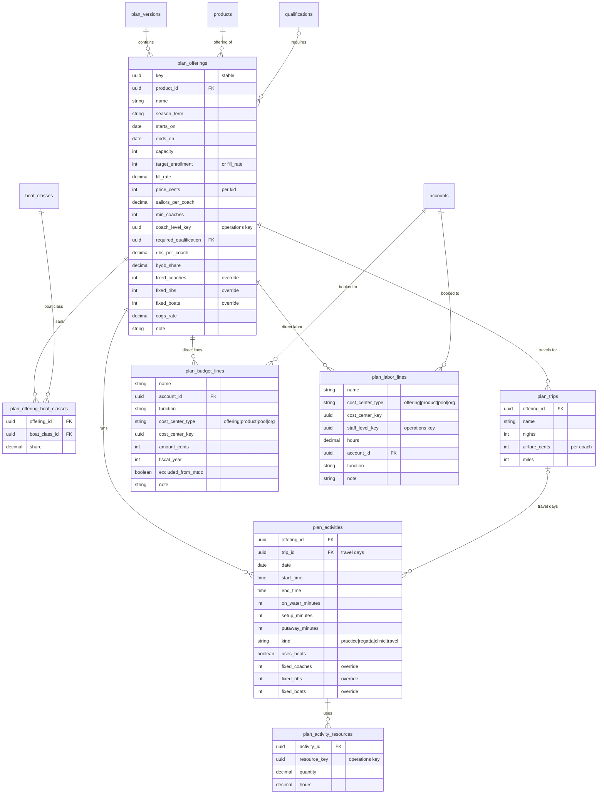
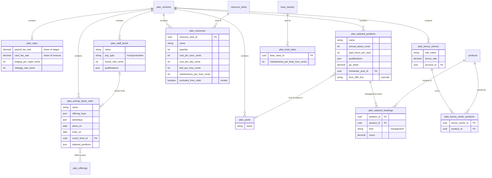
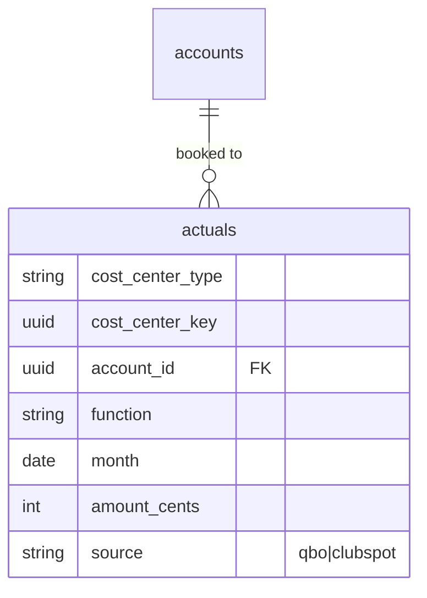

## Planning: schema

Entity-relationship diagrams for the program planning and financial model app. `schemas/core.yaml` declares the `core` catalog, except `offering_external_refs`. `schemas/planning.yaml` declares plans, their versions, which version is active, and every row a version holds. Version sets, scenarios, baselines and actuals are designed here, but not built yet.

The database stores only what planners enter, not totals calculated from it. Apps and agents ask the [planning engine](planning-engine.md) to calculate a P&L when they need one.

### Terms

- **Product:** a lasting thing CYC sells, such as J-Pod Race Team, boat charters or storage leasing. Products live in the new `core` domain.
- **Program:** a product of kind `program`, such as J-Pod Race Team. Each application groups programs its own way: the website by category, finance by revenue account, Google Workspace by Group. So no single program hierarchy exists.
- **Offering:** a product sold for a period, such as J-Pod Fall 2027 or Guppies summer week 3. A program offering is one Clubspot session × class, the unit Clubspot caps enrollment on.
- **Activity:** one dated, timed event that uses coaches, boats or other resources, such as a practice, a regatta day or a travel day. The planner, or a scheduling tool, enters each one.
- **Activity block:** offerings whose activities share coaches and boats on certain days, set up by the planner. For example, J-Pod and K-Pod on Wednesdays.
- **Cost center:** what a money line belongs to. That is an offering, a product (divided among its offerings), a pool (G&A, program admin), or the org. Strictly speaking, an offering that earns revenue is a profit center, but we call all of these cost centers.
- **Bonus owner:** a role, such as Single-handed head coach. It owns a set of products and earns a bonus on their combined net.
- **Plan:** one part of the club's overall plan, saved and versioned on its own. A **Program Plan** (or a Charter Plan, a Storage Plan and so on) holds one product's offerings. The **Operations Plan** holds what products share.
- **Version:** either a draft or an immutable saved snapshot of one plan.
- **Version set:** one version per plan.
  - The **active version set** is "the plan".
  - A **scenario** is a version set with some versions swapped, added or dropped.
  - A **baseline** is a frozen version set that variance is measured against.

### Diagram conventions

Every version-scoped entity also has an `id`, a `version_id` and a `key`. A new row gets a random `key` unless it's given one, and a copy into a new draft keeps it. A `key` should be unique within its version, but Directus can't make a pair of columns unique, so nothing checks it. The diagrams below leave these out except where they matter.

Arrays are shown as `json`.

Dashed lines are references by stable `key` across plans. The engine looks them up within a version set; they are not database foreign keys.

### `core` catalog

`programs` is the subtype of a product of kind `program`, per `AGENTS.md`'s subtype pattern. A product with a program can't be deleted. `organizations` holds each organization's fiscal year. `organization_cost_accounts` lists which account each calculated cost (coach wages, payroll tax, card fees and so on) is recorded in, one row per cost type. Directus can't make a pair of columns unique, so nothing stops a second row for a cost type, and the engine then uses whichever it reads last. Staff levels, resource kinds and boat rates name no account. QuickBooks Classes split those accounts by program, which the engine's per-product P&L shows.

### Versioning

A plan starts with a draft. A Plan Writer saves it by setting its `status` to `saved`, with the `platform_version` of the engine (`@cyc-seattle/platform`) that calculated its numbers, so we can recalculate them the same way later. To change a saved plan, make a new draft whose `parent_version_id` is the saved version, and copy its rows, keys included.

A plan's active version is its newest `plan_activations` row, so only one is active at a time. Making a version active adds a row, which must name a saved version of the plan. A Plan Writer adds rows, and never changes or deletes one. `version_sets` and `version_set_members` wait for scenarios and baselines.

#### A saved version never changes

A saved version, and every row in it, never changes, even for an admin. `schemas/*.yaml` can't declare a database trigger, and Directus skips permissions for an admin, so the `saved-versions` hook (`stacks/backend/saved-versions.cjs`) enforces it. Directus runs its filters for every user. It refuses, with a 403, any request that would:

- change or delete a saved version, or turn it back into a draft
- add, change or delete a row in a saved version, or move a row into one
- make a new version that isn't a draft

It also stamps `saved_by` and `saved_at` when a draft is saved, refuses a save without a `platform_version`, and stamps `activated_by` and `activated_at` on an activation.

Every foreign key from a plan row restricts delete, so deleting a catalog row a version uses, or a plan with versions, fails instead of cascading into a saved version. Archive a plan instead of deleting it. Only SQL run as the database's owner gets past this. In dev, `backend:savedVersionsDeletable` lets the first admin account delete a saved version, so the integration tests can clean up. The prod stack refuses that flag.

### Product plan (one version)

All of an offering's revenue and costs go in the plan year it starts in, even if it runs into the next year. Its enrollment is a whole number of kids, and its revenue is `price_cents` × enrollment.

Each activity is a dated row. The planner enters them, or a tool such as a scheduler or an agent writes them; nothing creates them automatically. A travel day is an activity of kind `travel`, linked to its trip.

A budget line counts in its `fiscal_year`, and buying equipment is a cost in the year it's bought. A cost on a product is divided among the product's offerings by MTDC (modified total direct costs: an offering's own costs, less a few kinds a federal grant rule leaves out). `excluded_from_mtdc` leaves a cost out of MTDC, as [2 CFR 200.1](https://www.ecfr.gov/current/title-2/section-200.1) does for equipment, rent, participant support and the rest. `plan_labor_lines` hold labor not tied to an activity, such as head-instructor weeks, training and boat-maintenance labor, priced at a staff level.

### Operations plan (one version)

`plan_rates` holds the year's rates, in at most one row per version. Each staff level, salaried position, resource and boat rate also has one rate for the year, so each has a single row.

A pool is a group of shared costs that no single offering owns, such as general and administrative (G&A) costs or program admin. It holds the lines put in it, and the part of a salaried person's pay that isn't charged to a program. Everything in a pool is divided among all of the year's offerings by MTDC.

A bonus owner's bonus is `bonus_rate` × the combined net of its products for the year, after pools, if that net is above zero.

The Operations Plan also holds `plan_budget_lines` and `plan_labor_lines` for pool and org lines (insurance, the clubhouse fee, fundraising, equipment). They have the same shape as the product plan's lines.

### Actuals

Actuals are what QuickBooks and Clubspot recorded. To compare them with a plan, add up a plan year's actuals and compare them with the engine's lines for the same cost centers and accounts.
