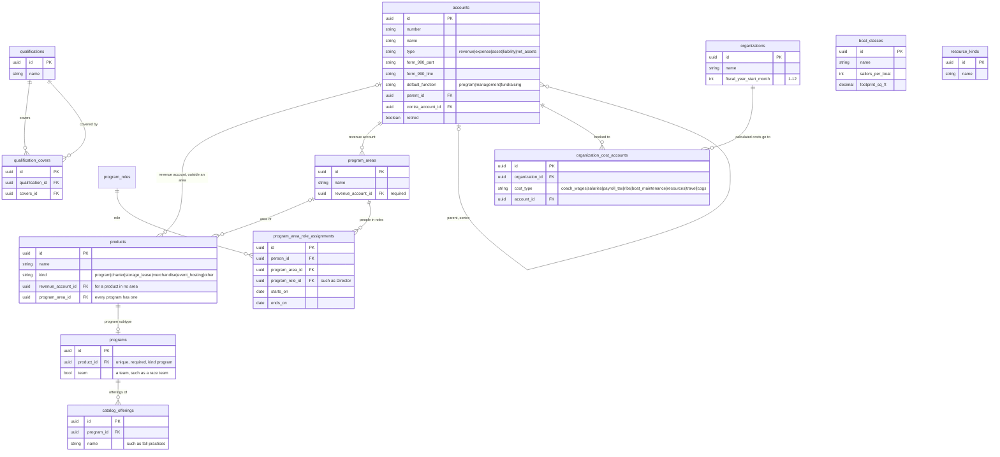
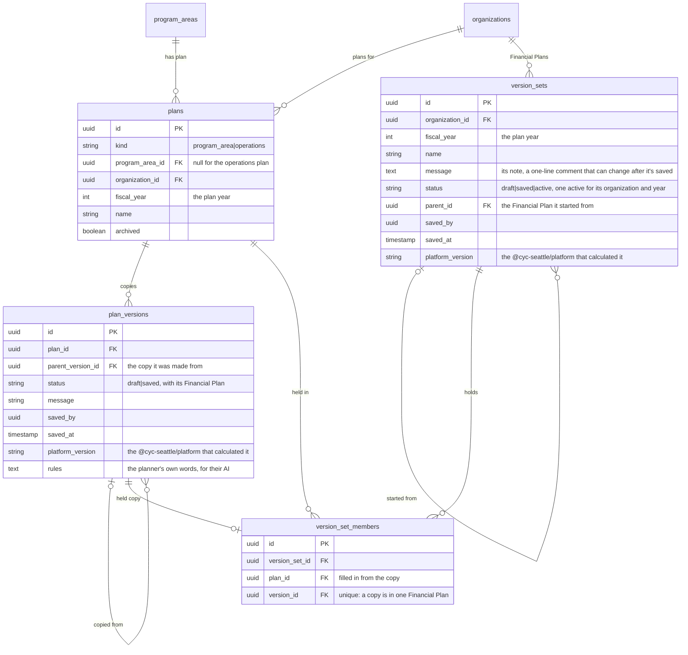
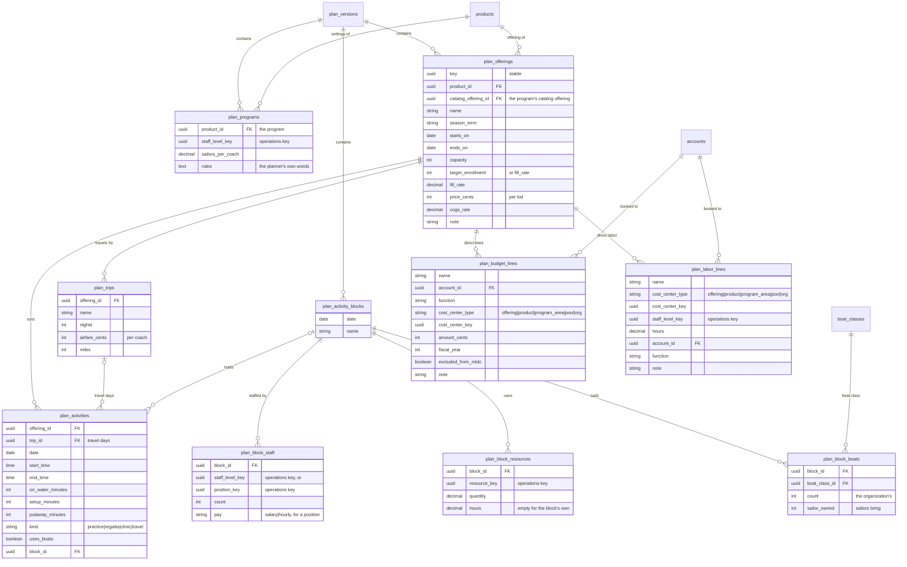
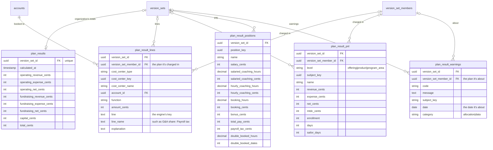
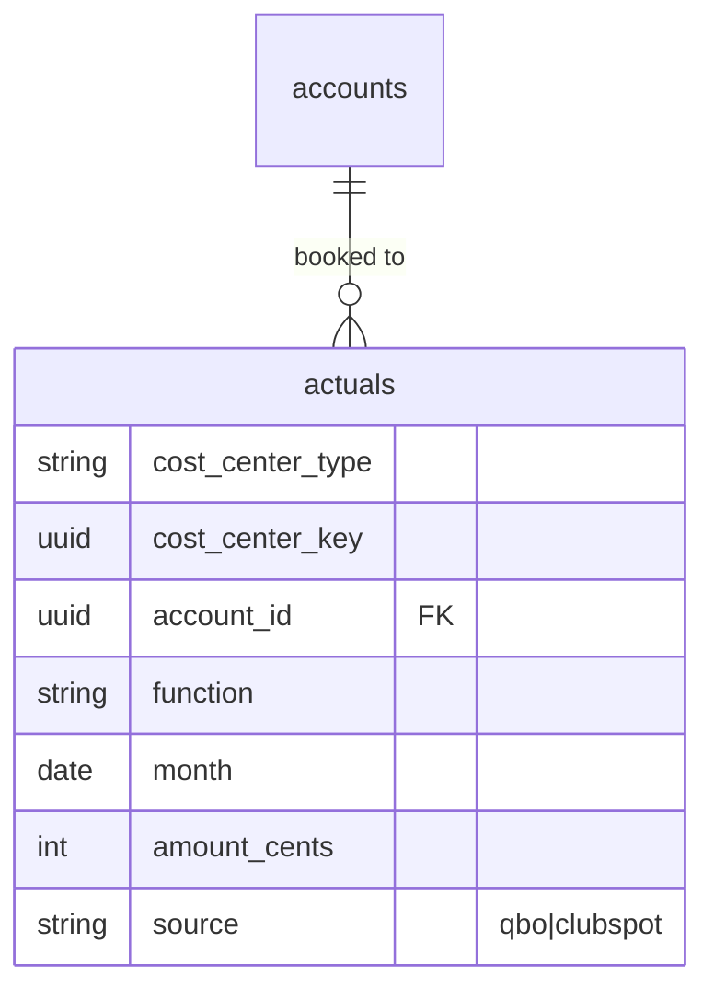

## Planning: schema

Entity-relationship diagrams for the program planning and financial model app. `schemas/core.yaml` declares the `core` catalog. `schemas/planning.yaml` declares Financial Plans, the plans they hold, every row a plan holds, and which Financial Plan is active. Baselines and actuals are designed here, but not built yet.

A Financial Plan holds what planners enter, and the results the [planning engine](planning-engine.md) calculates from it ([A Financial Plan's results](#a-financial-plans-results)). A draft's are worked out again a moment after each change to it. A saved one's are worked out when it's saved, and never change.

### Terms

- **Product:** a lasting thing CYC sells, such as J-Pod, boat charters or storage leasing. Products live in the new `core` domain.
- **Program:** a product of kind `program`, such as J-Pod. A program with `team` set is a team, such as a race team. Each application groups programs its own way: the website by category, Google Workspace by Group.
- **Program area:** one part of the organization's programs, such as Summer or Singlehanded, with one revenue account. People hold roles in it, such as Director, the way they hold program roles, and its directors plan it. Every program belongs to one. Areas are the program services the organization reports in Part III of Form 990. Merchandise, storage and charters belong to none.
- **Offering:** a product sold for a period, such as J-Pod Fall 2027 or Guppies summer week 3. A program offering is one Clubspot session × class, the unit Clubspot caps enrollment on.
- **Activity:** one dated, timed event that uses coaches, boats or other resources, such as a practice, a regatta day or a travel day. The planner, or a scheduling tool, enters each one.
- **Activity block:** offerings whose activities share coaches and boats on certain days, set up by the planner. For example, J-Pod and K-Pod on Wednesdays.
- **Cost center:** what a money line belongs to. That is an offering, a product or a program area (each divided among its offerings), a pool (G&A, program admin), or the org. Strictly speaking, an offering that earns revenue is a profit center, but we call all of these cost centers.
- **Bonus owner:** a role, such as a program area's director. It owns a set of products and earns a bonus on their net. A bonus on one area's products is in that area's plan; one across areas is in the Operations Plan.
- **Catalog offering:** a named offering of a program, such as "J-Pod · fall practices" or "Summer camp · week 3", kept in the catalog. Every Financial Plan's offerings point at one, and so do Clubspot's offerings, so a Clubspot offering finds its plan in whichever Financial Plan is active.
- **Plan:** one part of a Financial Plan. A **Program Plan** holds one program area's offerings for one year. The **Operations Plan** holds what the areas share, the charges set as a share of revenue, and the products in no area: merchandise, storage and charters.
- **Plan copy** (`plan_versions`): one plan as one Financial Plan holds it, with every row. A draft until its Financial Plan is saved.
- **Financial Plan** (`version_sets`): the organization's plan for a year: one Operations Plan and a Program Plan for any of the program areas, with the P&L they make together. Planners change its plans while it's a draft, and saving it saves them all. Then it never changes, apart from its name and note. A new one starts as a copy of its parent, so two started from the same parent are options to compare, like branches in git.
  - The **active** Financial Plan is the one a planner marked active last for its organization and year: the plan being run, which tracking compares with what happened.

### Diagram conventions

Every version-scoped entity also has an `id`, a `version_id` and a `key`. A new row gets a random `key` unless it's given one, and a copy into a new draft keeps it. A `key` should be unique within its version, but Directus can't make a pair of columns unique, so nothing checks it. The diagrams below leave these out except where they matter.

Arrays are shown as `json`.

Dashed lines are references by stable `key` across plans. The engine looks them up within a Financial Plan; they are not database foreign keys.

### `core` catalog

`programs` is the subtype of a product of kind `program`, per `AGENTS.md`'s subtype pattern. A product with a program can't be deleted.

A program area has one revenue account, and a product in an area books its sales there. A product's own `revenue_account_id` is for products in no area, and the Data Studio hides it once an area is set. The Data Studio asks for an area on a program and hides it on other kinds, but the database doesn't require one, since prod's programs had none when areas arrived. The engine warns about a program with no area, and the Google sync's audit about a product whose own account differs from its area's. A program area with products can't be deleted. Who holds a role in an area, such as Director, is in `program_area_role_assignments`, in the CRM schema beside `program_role_assignments`, with the same access: the CRM policies. Anyone who signs in can see each area's name. `organizations` holds each organization's fiscal year. `organization_cost_accounts` lists which account each calculated cost (coach wages, payroll tax, and so on) is recorded in, one row per cost type. Directus can't make a pair of columns unique, so nothing stops a second row for a cost type, and the engine then uses whichever it reads last. Staff levels, resource kinds and boat rates name no account. QuickBooks Classes split those accounts by program, which the engine's per-product P&L shows.

### Financial Plans

A plan is for one organization and one plan year (`fiscal_year`). A Program Plan names its program area, and an Operations Plan names none. A plan's kind, program area, organization, and year can't change once it's in a Financial Plan or has a saved copy, since its Financial Plan checked them when it joined.

A plan copy's `rules` hold what the planner wants that the plan's numbers don't capture, in their own words, such as "every Monday, Wednesday and Friday, except on school holidays, from 4pm until dusk". Their AI reads them when it fills in the plan. The engine never does. Like every input, they're saved with the Financial Plan and never change after.

A Financial Plan is for one organization and year, and holds one Operations Plan copy and at most one Program Plan copy for each program area, each in no other Financial Plan. A year can have several drafts at once, to weigh options. A planner starts one by adding a `version_sets` row in the Data Studio, which calls them Financial Plans. Given a `parent_id`, a Financial Plan for the same organization and year, the `saved-versions` hook copies the parent's plans into it a moment after: a draft copy of each, with every row, each keeping its `key`, and each link pointing at the copy of the row it linked to. A planner can also add a plan's draft copy to it by hand, as a `version_set_members` row, and take one out. Members change only while the Financial Plan is a draft. Its organization, year, and parent never change.

A Plan Writer saves a Financial Plan by setting its `status` to `saved`. Saving it saves every plan copy in it, in the same statement, so they're saved together, and the database refuses it without an Operations Plan. A plan copy is never saved on its own. The hook records the `platform_version` of the engine (`@cyc-seattle/platform`) that calculates the results, whatever the request sends: the package's version and a hash of the engine's code. It stamps the same on each plan copy. Then it works out the results again ([A Financial Plan's results](#a-financial-plans-results)). A saved Financial Plan never changes, apart from its `name` and its note (`message`), such as "Reviewed with the board". A Program Plan's row that names an Operations Plan row by key, such as `coach_level_key`, means the row with that key in the Operations Plan copy of the same Financial Plan.

A saved Financial Plan doesn't copy the catalog. Recalculating an old one uses the catalog as it is today: today's products, accounts, boat classes, and the organization's fiscal year.

A Plan Writer marks a saved Financial Plan active by setting its `status` to `active`. An active Financial Plan is a saved one: it's frozen the same way, and has the same results. An organization's year has at most one, which a partial unique index on `version_sets` keeps. Marking one active sets the one active before it back to `saved`, in the same statement. No one sets an active one back by hand. Directus's revisions record who marked one active, and when (cyc-seattle/sail-team#50).

#### A saved Financial Plan never changes

A saved Financial Plan, every plan copy in it, and every row in those, never change, even for an admin. Directus skips permissions for an admin, so two things enforce it:

- The `saved-versions` hook (`stacks/backend/saved-versions.cjs`) refuses such a request with a 403 and a clear reason. Directus runs its filters for every user. The hook also stamps who saved a Financial Plan. A write that skips the hook, such as a flow's data step, leaves `saved_by` empty.
- Database triggers refuse the same writes on every path, including the ones that skip Directus's filters, such as a flow's data steps. The hook installs them when Directus starts, and again after each schema change if they've changed or a table lost its trigger. An install gives up after 5 seconds waiting for a lock, and logs the failure. The install also drops the unique indexes `plans` once had, which allowed one plan per product or year. The `saved-versions-check` step of the `backend` deploy, which runs whenever the schema or the triggers change, fails the deploy if a planning table lacks its trigger. Each one locks the copy it checks until the write commits, so a Financial Plan can't be saved while a write to one of its rows is still open. Directus shows a trigger's refusal with its reason when it creates or updates a row. When it deletes one, it answers with a 500, which shows the reason only to an admin.

Together they refuse:

- changing a saved Financial Plan, apart from its name, its note, and marking it active, turning it back into a draft, or deleting it
- saving a Financial Plan without an Operations Plan, or without a `platform_version`
- a new Financial Plan that isn't a draft, or one that starts from another organization's or year's
- changing a Financial Plan's organization, year, or parent
- adding, changing, or taking out a saved Financial Plan's plans
- a member that isn't a draft copy, is for another organization or year, is in another Financial Plan, or is a second Operations Plan or a second Program Plan for its area
- saving a plan copy on its own, changing or deleting a saved one, or a new copy that isn't a draft
- adding, changing, or deleting a row in a saved copy
- moving a row to another copy, or a copy to another plan
- a row that links to a row in another copy, such as an activity whose `offering_id` is another copy's offering
- a Program Plan without its program area, or an Operations Plan with one
- writing a Financial Plan's results, except by the hook, a whole set at a time into one with none, or changing or deleting a saved one's
- marking a draft active, or setting an active one back to saved, except by marking another one active
- changing a plan's kind, program area, organization, or year once it's in a Financial Plan or has a saved copy

Every foreign key from a plan row restricts delete, so deleting a catalog row a plan uses, or a plan with copies, fails instead of cascading into a saved one. Archive a plan instead of deleting it. Deleting a draft Financial Plan takes its plans out of it, and leaves the copies.

An admin can still get past this in two ways, as a last resort: by changing a planning collection's fields or relations in the Data Studio, which changes the table itself, or by running SQL as the database's owner, which can turn the triggers off. In dev, `backend:savedVersionsDeletable` lets the integration tests delete a saved Financial Plan, its plans and their rows, and its results, so they can clean up. Through the API, only the first admin account can. The triggers can't tell which Directus user is writing, so in dev's database they allow those deletes on every path. The prod stack refuses that flag.

`mise run delete-plans` gets past them on purpose, as the database's owner: it empties every planning table in `PULUMI_STACK`'s database, saved plans included, for the move to dated blocks ([cyc-seattle/platform#149](https://github.com/cyc-seattle/platform/issues/149)). It's run by hand, never by a deploy. It shows how many Financial Plans it would delete and asks you to type the stack's name first. Prod's run waits for the maintainer's confirmation.

### Program Plan (one copy)

All of an offering's revenue and costs go in the plan year it starts in, even if it runs into the next year. Its enrollment is a whole number of kids, and its revenue is `price_cents` × enrollment.

Each activity is a dated row. The planner enters them, or a tool such as a scheduler or an agent writes them; nothing creates them automatically. A travel day is an activity of kind `travel`, linked to its trip.

Each program has one `plan_programs` row in its area's Program Plan: the staff level that coaches it, how many sailors one coach at that level can take, and its `rules`. Like the Program Plan's own `rules` and the Operations Plan's, a program's rules are the planner's words for their AI, and the engine never reads them ([cyc-seattle/platform#149](https://github.com/cyc-seattle/platform/issues/149)). Being in a plan copy, they're versioned, so two drafts can try different settings. Directus can't make a pair of columns unique, so nothing stops a second row for a program, and the engine then uses whichever it reads last.

A block, in `plan_activity_blocks`, is one or more activities on one date that share their staff and boats, such as Guppies and Minnows on the morning of July 13. Each activity is in at most one block, through `block_id`. A block's rows say what it's given: `plan_block_staff`, a number at a staff level or one salaried position, paid out of the salary or by the hour; `plan_block_resources`, RIBs and other equipment; and `plan_block_boats`, the organization's boats of a class and the ones sailors bring. The planner, or their AI, writes them. Nothing derives them, and nothing records which rule made them. Every foreign key restricts delete, so a block's rows, and its activities' `block_id`, go before the block does.

A program area's plan holds only offerings of that area's programs, and the engine warns about any other.

A budget line counts in its `fiscal_year`. Capital, a line on an asset account such as buying a coach boat, is the organization's: fundraising pays for it, so it never reaches an area or an offering, and the engine moves it to the organization with a warning. A cost on a product or a program area is divided among its offerings by MTDC (modified total direct costs: an offering's own costs, less a few kinds a federal grant rule leaves out). `excluded_from_mtdc` leaves a cost out of MTDC, as [2 CFR 200.1](https://www.ecfr.gov/current/title-2/section-200.1) does for equipment, rent, participant support and the rest.

`plan_labor_lines` hold labor not tied to an activity, such as head-instructor weeks, training and boat-maintenance labor, priced at a staff level.

### Operations Plan (one copy)

```mermaid
erDiagram
    plan_versions ||--o| plan_rates : contains
    plan_versions ||--o{ plan_staff_levels : contains
    plan_versions ||--o{ plan_salaried_positions : contains
    plan_versions ||--o{ plan_resources : contains
    plan_versions ||--o{ plan_pools : contains
    plan_versions ||--o{ plan_bonus_owners : contains
    plan_versions ||--o{ plan_closed_dates : contains
    resource_kinds ||--o{ plan_resources : "kind of"
    resource_kinds |o--o{ plan_rates : "RIB kind"
    boat_classes ||--o{ plan_boat_rates : "rate for"
    plan_salaried_positions ||--o{ plan_salaried_bookings : "management hours"
    products |o--o{ plan_salaried_bookings : "booked to"
    program_areas |o--o{ plan_salaried_bookings : "booked to"
    plan_versions ||--o{ plan_revenue_charges : contains
    accounts ||--o{ plan_revenue_charges : "booked to"
    plan_salaried_positions }o--o| plan_pools : "rest of salary to"
    people |o--o{ plan_salaried_positions : "in the position"
    plan_bonus_owners ||--o{ plan_bonus_owner_products : owns
    products ||--o{ plan_bonus_owner_products : "owned by"

    plan_rates {
        decimal payroll_tax_rate "share of wages"
        int lodging_per_night_cents
        int mileage_rate_cents
        uuid rib_resource_kind_id FK "which resource kind is safety boats (RIBs)"
    }
    plan_staff_levels {
        string name
        string pay_type "hourly|volunteer"
        int hourly_rate_cents
        json qualifications
        boolean retired "kept for the coaches who have it"
    }
    plan_salaried_positions {
        string name
        int annual_salary_cents
        int paid_hours_per_year
        json qualifications
        decimal ga_share
        uuid remainder_pool_id FK
        string form_990_line "override"
        int hourly_coaching_rate_cents "its own rate, when paid by the hour"
        uuid person_id FK "the person in it"
    }
    plan_salaried_bookings {
        uuid position_id FK
        uuid product_id FK "or the area"
        uuid program_area_id FK "or the product"
        string kind "management"
        decimal hours
    }
    plan_resources {
        uuid resource_kind_id FK
        string name
        int quantity
        int cost_per_hour_cents
        int cost_per_day_cents
        int fuel_per_hour_cents
        int maintenance_per_hour_cents
        boolean excluded_from_mtdc "rentals"
    }
    plan_boat_rates {
        uuid boat_class_id FK
        int maintenance_per_boat_hour_cents
        int quantity "boats the organization has"
    }
    plan_pools {
        string name
    }
    plan_revenue_charges {
        string name
        decimal rate "share of each offering's revenue"
        json product_kinds
        uuid account_id FK "revenue adds revenue, expense a cost"
        boolean excluded_from_mtdc
        string note
    }
    plan_bonus_owners {
        string role_name
        decimal bonus_rate
        uuid account_id FK
        string basis "after_shared_costs|before_shared_costs"
        uuid position_key "operations key: the position it pays"
    }
    plan_closed_dates {
        date date
        string name
    }
    plan_bonus_owner_products {
        uuid bonus_owner_id FK
        uuid product_id FK
    }
```

`plan_rates` holds the year's rates, in at most one row per version. Each staff level, salaried position, resource and boat rate also has one rate for the year, so each has a single row.

The fleet is the `quantity` of each resource, such as RIBs, and of each boat class's `plan_boat_rates`. The engine warns when the blocks give out more at once than the organization has. Empty means it isn't checked; for a boat class the blocks use, the engine warns about that too.

`plan_revenue_charges` lists the charges set as a share of revenue, such as scholarships, the program buffer, B&O tax, and card fees. Each applies to every offering of the product kinds it names, at its rate × the offering's revenue. A charge on a revenue account adds revenue, such as the card fees families pay; on an expense account, it adds a cost. `excluded_from_mtdc` leaves it out of MTDC, as for scholarships, which are participant support.

The Operations Plan also holds the offerings of products in no area: merchandise, storage and charters.

A salaried booking names a product, or a program area whose offerings share it by MTDC.

A salaried position can name the person in it. The engine doesn't read it. Plans budget coaches by
staff level and name no coaches; CSC's coaches are a lasting list outside the plans
([docs/staff-schema.md](staff-schema.md)), each at a staff level's key. A retired level stays in the
plan, so its coaches keep it, and the engine still prices it wherever a block or labor line uses it.

A pool is a group of shared costs that no single offering owns, such as general and administrative (G&A) costs or program admin. It holds the lines put in it, and the part of a salaried person's pay that isn't charged to a program. Everything in a pool is divided among all of the year's offerings by MTDC.

A bonus owner's bonus is `bonus_rate` × the net of its products for the year, after or before the pools (`basis`), if that net is above zero. A bonus on one program area's products can be in that area's plan instead, with its own `plan_bonus_owner_products`; the engine ignores, with a warning, any product from another area. `position_key` names the salaried position the bonus pays, so the engine can add up that person's pay.

`plan_closed_dates` lists the days the organization is closed, such as Labor Day. Agents read them when they write activities, and the engine warns about an activity on one.

The Operations Plan also holds `plan_budget_lines` and `plan_labor_lines` for pool and org lines (insurance, the clubhouse fee, fundraising, equipment). They have the same shape as an area plan's lines.

### A Financial Plan's results

The `saved-versions` hook runs the engine on the plans a Financial Plan holds and writes its results. Since a Financial Plan holds every plan it counts, each offering's share of the pools is right.

A draft's results are worked out again after each change to what they come from, wherever it was made: the app, the Data Studio, or MCP. That's a row in one of its plan copies, one of its plans, its members, or the catalog and organization the engine reads, which changes every draft's. Directus runs the hook's actions after it commits a write. The hook waits until a draft's writes have stopped for a second, or 10 seconds after the first, so a burst of them, such as an agent's over MCP, costs one run. It runs one draft at a time, on Directus's main thread. It replaces the draft's results in one transaction, under the locks a save takes, so readers see the old results or the new, never a mix. If that fails, it clears them, so no stale numbers look current, and logs why. When Directus starts, it works out the results of every draft that has none. A write that skips Directus's actions, such as SQL, leaves a draft's results as they were until its next change; `calculated_at` says when they were worked out.

Saving a Financial Plan clears its draft results in the same statement, and the hook works them out again a moment after the save answers, with the engine whose version it records. Then they never change.

`plan_results` holds the organization's totals. Each line and P&L row names, in `version_set_member_id`, the member that holds what it's charged to: an offering goes with its own plan, and a product or program area with that area's Program Plan. Everything else, including pools and the organization, goes with the Operations Plan. So one Program Plan's P&L, with its wages, RIBs and share of the shared costs, is one filter. A warning names the member it's about, if there is one, and the date. Its `category` is `allocation` when the blocks break a limit or run on a closed day, and `data` when a row is missing or wrong ([Warnings](planning-engine.md#warnings)). Positions are the whole calculation's. The hook writes `plan_results` last, so a Financial Plan that has it has all its results. If the engine fails, it stays saved with no results, and the hook logs why. An admin can fill them in with `POST /saved-versions/results/<Financial Plan id>`. If copying a parent fails, `POST /saved-versions/copy/<Financial Plan id>` tries again, and does nothing for one that already has plans.

Only the hook writes results. Its filter refuses any write to them through the API, even an admin's, and the triggers refuse a result row unless the hook's transaction has set `cyc.writing_results`, and the Financial Plan has no results yet. They refuse to delete a draft's results without it too, apart from the delete of the draft, or a plan taken out of it, taking its results with it. No result row is ever changed, and a saved one's are never deleted. A Plan Reader or Plan Writer can see them, a draft's the same way as a saved one's. A draft with no `plan_results` row is still being worked out, or the engine failed on it.

Each result line's `line_name` says in plain words what it is, such as "Coach wages" or "G&A share: Payroll tax". `line` is the engine's key for it.

### Actuals

Actuals are what QuickBooks and Clubspot recorded. To compare them with a plan, add up a plan year's actuals and compare them with the engine's lines for the same cost centers and accounts.
