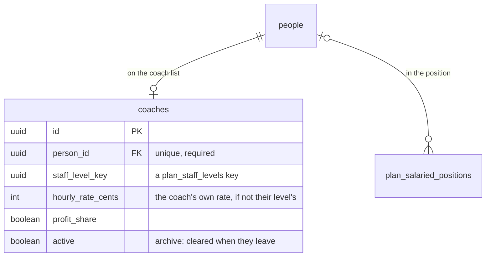

## Staff: schema

`schemas/staff.yaml` holds CSC's coaches: a lasting list of the people it employs to coach,
outside any Financial Plan ([cyc-seattle/platform#125](https://github.com/cyc-seattle/platform/issues/125)).
Plans still budget coaches by staff level ([docs/planning-schema.md](planning-schema.md)). They don't
name the coaches, apart from the person in a salaried position.

- A person is on the list once. A coach who leaves is archived by clearing `active`. Only an
  admin can delete a coach, since a CRM Writer can add and edit coaches but not delete them.
- A coach's level is a `plan_staff_levels` key. A level is a plan row, and its key stays the same in
  every copy of the Operations Plan, so the key finds the coach's level, and its rate, in whichever
  Financial Plan is being read. A level that's retired (`retired`) stays in the plan, so its coaches
  keep it. A key with no level in that Financial Plan means the coach's level isn't in it.
- `hourly_rate_cents`, when set, is what the coach is paid instead of their level's rate. It isn't
  versioned: it's the rate now.
- Being on the list gives no access. Crew is still an admin's decision.
- A CRM Reader reads the list, and a CRM Writer adds and edits it. The Plan policies read it,
  and read each person's first and last name, so a planner sees who's on it.
- A person merge stops while a duplicate is on the list, or in a salaried position, as it does for
  one in a group. An admin moves those by hand. A saved plan's position never changes, so a
  duplicate named in one stays.

Assigning coaches to the offerings they coach each term, and their hours, wages and overtime, come
later, once hours are recorded.
